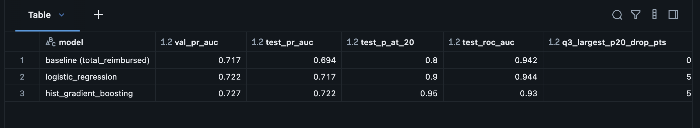
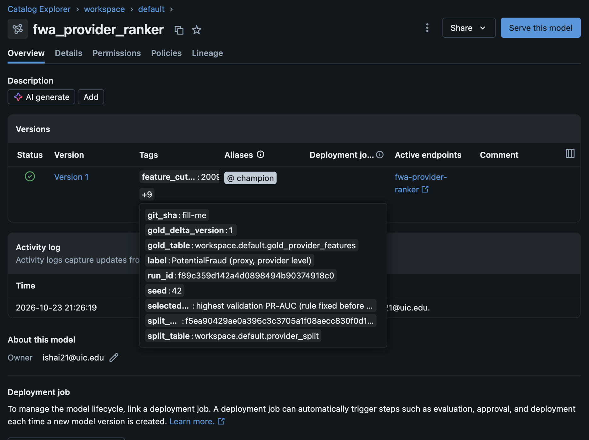
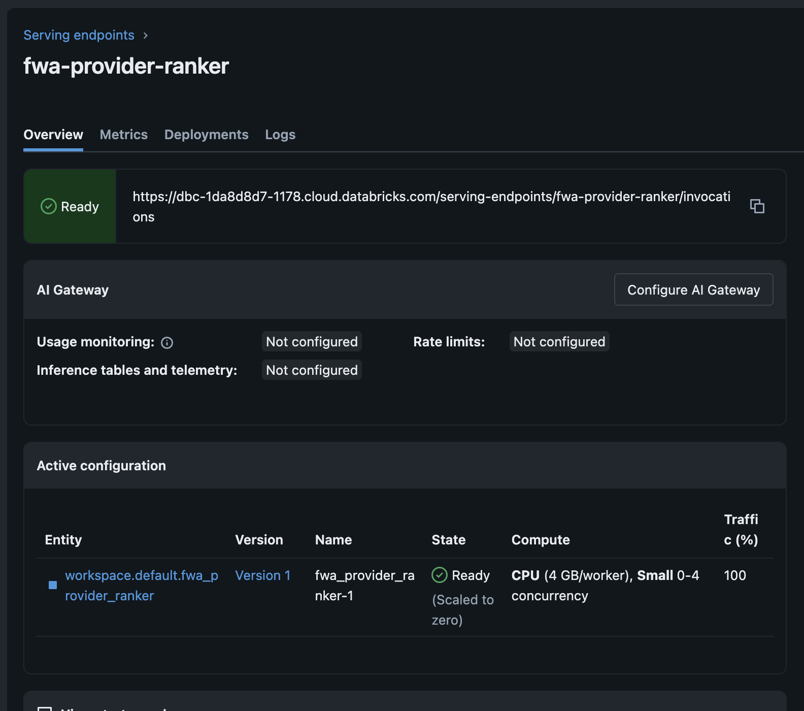
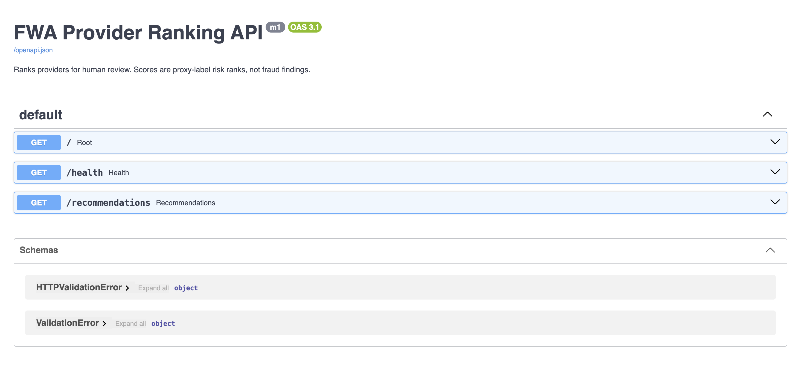
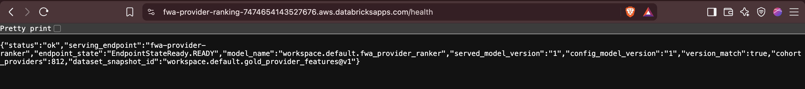
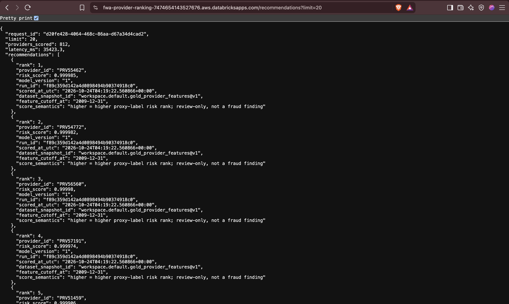
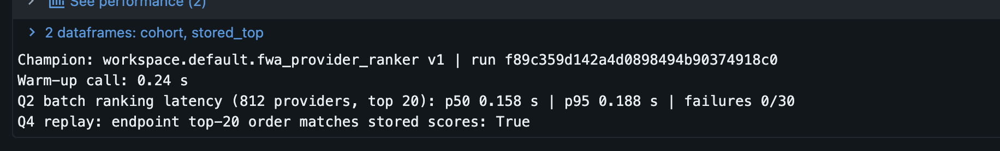

# Milestone 1 Report: FWA Provider Investigation Prioritization

**Course:** CS 544 / CS 590, Machine Learning in Production (Fall 2026)
**Team:** Javed, Irfan, Vipul
**Repository:** `fwa-ml-production` (code, notebooks, documentation and evidence for this milestone)
**Platform:** Databricks Free Edition (Unity Catalog, Delta, MLflow, Model Serving, Databricks Apps)

**Scope statement.** The system ranks healthcare providers so that a human analyst knows whom to review first. It uses only public benchmark data. A score is a ranking signal against a proxy label, not a fraud finding, and the system never takes any action on a provider or a claim.

---

## 1. Learning

**Data.** We use the public Kaggle *Healthcare Provider Fraud Detection Analysis* dataset: 5,410 providers with a provider-level label `PotentialFraud` (506 Yes, 9.4%), 40,474 inpatient claims, 517,737 outpatient claims and 138,556 beneficiaries (Nov 2008 to Dec 2009). The label is a **proxy**, not an adjudicated finding. The Kaggle Test files contain no labels, so all evaluation uses held-out providers from the labeled Train file. Details: [`data_dictionary.md`](data_dictionary.md).

**Features.** Claims and beneficiary data are aggregated into a Gold Delta table (`gold_provider_features`, version 1) with **one row per provider**. The model uses its **42 numeric features**, including claim counts (inpatient, outpatient), reimbursement totals and per-claim / per-beneficiary amounts, number of beneficiaries and active months, average claim duration and inpatient length of stay, diagnosis and procedure code variety, physician counts and shares, beneficiary age, chronic conditions and renal disease share, and peer-group comparisons of reimbursement. Text and date columns (`size_band`, `peer_group`, feature window dates) are not used as model inputs. Identifiers and the label are never model inputs.

**Split (frozen before training).** Providers are split **70 / 15 / 15** into train (3,787), validation (811) and test (812), stratified on the label so each set has 9.4% Yes (354 / 76 / 76). The split is on unique Provider IDs, so **no provider appears in two sets** (checked in code). Providers are sorted before splitting with seed 42, and a SHA-256 fingerprint of the assignment is stored (`f5ea90429ae0a396...`). The same fingerprint was produced by an earlier local proof of concept on a laptop, which confirms the split is reproducible across environments. The split is saved as the Delta table `provider_split`.

**Models.** We train three candidates on the training set only:

| Candidate | Description |
|---|---|
| Baseline | No learning: rank providers by `total_reimbursed`. Fixed before viewing held-out results. |
| Logistic Regression (LR) | Median imputation, `arcsinh` transform for heavy-tailed values, standard scaling, balanced class weights |
| HistGradientBoosting (HGB) | Median imputation, 300 iterations, learning rate 0.05, balanced class weights |

All preprocessing lives inside each scikit-learn pipeline, so it is fitted on the training set only. Each run is logged in **MLflow** with its metrics and tags: Gold table and Delta version, split table and fingerprint, seed, feature cutoff date (2009-12-31) and Git commit. Models are logged to return probabilities (`predict_proba`) so that providers can be ranked.

**Champion rule (fixed before testing).** The champion is the model with the highest **validation PR-AUC**. The test set is scored once, after the choice.

---

## 2. Model comparison

We measure four qualities, each defined in T04 as metric, data gathered and operationalization:

- **Q1 Ranking usefulness:** proxy Precision@20 (share of the top 20 labeled Yes), with PR-AUC as a whole-list supplement.
- **Q2 Responsiveness:** p95 latency of one batch ranking request (score all 812 cohort providers, return the top 20).
- **Q3 Robustness:** largest drop in P@20, in percentage points, when inputs are multiplied by small random noise (5% and 10%, 10 trials each) with labels unchanged.
- **Q4 Auditability:** share of top-20 records carrying every required trace field, plus replay agreement.

**Results on the held-out test providers (812 providers, 76 Yes, base rate 9.4%):**

| Model | Val PR-AUC | Test PR-AUC | Test P@20 | Test ROC-AUC | Q3 worst P@20 drop |
|---|---|---|---|---|---|
| Baseline (`total_reimbursed`) | 0.717 | 0.694 | 0.80 | 0.942 | 0 pts |
| Logistic Regression | 0.722 | 0.717 | 0.90 | 0.944 | 5 pts |
| **HistGradientBoosting (champion)** | **0.727** | **0.722** | **0.95** | 0.930 | 5 pts |

Champion-only service measures: **Q2** warm p95 = **0.188 s** (p50 0.158 s, 0 failures in 30 requests); **Q4** trace completeness = **20/20**, and the served top 20 exactly matches the stored scored ranking.





**Interpretation.**
- **The champion's top 20 contains 19 proxy-positive providers**, versus 16 for the baseline and about 2 expected from random selection.
- HGB was selected on validation and is also best on test PR-AUC and P@20. No choices were tuned on test results.
- **A one-feature baseline is already strong** (test PR-AUC 0.694). The proxy label is closely tied to provider size and billing volume. The models add a modest gain in PR-AUC and a clear gain at the top of the list (P@20 0.80 to 0.95), which is what an analyst sees.
- **Robustness:** a 5-point drop means at most one top-20 provider changed under noise.
- **Uncertainty:** each holdout set has only 76 positives, so PR-AUC differences of about 0.005 are within noise and P@20 moves in steps of 0.05. We describe LR and HGB as comparable, with HGB slightly ahead.

**Limitations.** (1) Proxy label only. (2) Peer-group features in Gold were computed over all providers without labels; strictly, aggregates should come from training data only, which we will revisit in M2. (3) A local pilot run used the same frozen split before the final run; it informed acceptance thresholds but no modeling choices. (4) Acceptance thresholds remain pending team and instructor approval.

---

## 3. Prediction service

**Architecture.**

```
Unity Catalog model  workspace.default.fwa_provider_ranker  v1 (@champion)
        |
Model Serving endpoint  fwa-provider-ranker   (CPU, Small, scale to zero)
        |
FastAPI app  fwa-provider-ranking  on Databricks Apps
        |-- GET /health
        |-- GET /recommendations?limit=20
        |-- GET /docs   (interactive API documentation)
```

**Model serving.** The champion version is deployed by code: the notebook reads the `@champion` alias and creates or updates the endpoint only if the served version differs. Scale to zero keeps Free Edition usage low. Before building the API we verified that the endpoint returns **identical probabilities** to the notebook model.



**API.** The FastAPI app (`app.py`, `app.yaml`, `requirements.txt`) is kept separate from the training notebook. The notebook exports two handoff files: `cohort.csv` (the frozen 812-provider scoring cohort with its 42 features) and `app_config.json` (model name and version, run ID, endpoint, data snapshot, cutoff date, split fingerprint, feature list). The app runs as its own service principal, which has only **Can Query** on the endpoint (least privilege).

- **`/health`** reports the endpoint state, the served model version, whether it matches the configured version, and the cohort size.
- **`/recommendations?limit=20`** sends the cohort to the endpoint in one request, sorts providers by score (ties broken by provider ID, so the order is deterministic), and returns the top N. If fewer than N providers are eligible it answers "top-N not evaluable". If the model is unreachable it returns HTTP 503 instead of failing silently.

**Output contract (each recommendation row):** `rank`, `provider_id`, `risk_score`, `model_version`, `run_id`, `scored_at_utc`, `dataset_snapshot_id`, `feature_cutoff_at`, `score_semantics`; each response also carries a `request_id`, `providers_scored` and `latency_ms`.







Sample (first row of `/recommendations?limit=20`):

```json
{"rank": 1, "provider_id": "PRV55462", "risk_score": 0.999985, "model_version": "1",
 "run_id": "f89c359d142a4d0898494b90374918c0", "scored_at_utc": "2026-10-24T03:44:30Z",
 "dataset_snapshot_id": "workspace.default.gold_provider_features@v1",
 "feature_cutoff_at": "2009-12-31",
 "score_semantics": "higher = higher proxy-label risk rank; review-only, not a fraud finding"}
```

**Latency.** Warm batch ranking of 812 providers: p50 0.158 s, **p95 0.188 s**, 0 failures in 30 requests. After the endpoint has been idle, the first request takes about **35 s** (cold start caused by scale to zero); we report it separately because it is a cost-versus-latency trade-off of the Free Edition setup.



**Traceability.** Every row links back to the model version, the MLflow run, the Gold Delta version and the frozen split fingerprint. Replaying the ranking through the endpoint reproduced the stored top 20 exactly.

**Not yet done.** Persisting each request in Lakebase (T15) and reading the cohort live from Delta instead of a frozen file are planned for M2.

**Evidence:** step-by-step walkthrough of every notebook cell and the API in [`M1_Pipeline_Walkthrough.md`](M1_Pipeline_Walkthrough.md); screenshots in `docs/milestones/M1/evidence/` (shown inline above).

---

## 4. Team process

*To be completed by each team member. Please answer the questions under your name, briefly and factually.*

**Questions for each member:**
1. Which tasks did you own or contribute to (task IDs from the tracker, e.g. T01, T08)?
2. What did you deliver (files, tables, notebooks, documents)? Link them in the repository if possible.
3. Roughly how many hours did you spend, and when?
4. What problems did you hit and how were they resolved (or are they still open)?
5. What will you take on for M2?

### Javed
T01: Project charter, Databricks capability/quota decision and use boundary
T03: Select the public FWA dataset; profile labels and files; draft data dictionary
T04: Provider-ranking use case and four M1 quality measures
T05: Governance: label limitations, human-review policy, model-card template
T10: Review the four M1 report sections
T11: M1 acceptance review and submission readiness

### Irfan
T06: Provider-disjoint train/validation/test split and train-only preprocessing
T07: Logistic Regression baseline on Gold features, logged in MLflow
T12: HistGradientBoosting challenger and comparison with the baseline
T13: FastAPI /health and /recommendations in Databricks Apps

### Vipul
T02: Repo scaffold and Databricks CLI/Bundles smoke test
T08: Kaggle CSVs into a UC volume; 4 Bronze Delta tables plus a checksum manifest
T09: Gold provider features (5,410 × 42, labels separate), 16 validation checks, Lakebase schema draft
T14: Versioned Gold snapshot and feature manifest (in progress)
T15: Lakebase recommendation queue with model and data version IDs (in progress)

## Meetings and decisions

| Date | Who attended | Decisions / actions | Owner | Deadline |
| --- | --- | --- | --- | --- |
| Oct 7, 2026 | Javed, Irfan, Vipul| Lunch discussion to choose between two project options, MNG and FWA; leaning toward FWA | All | Oct 9, 2026 |
| Oct 9, 2026 | Javed, Irfan, Vipul | Reviewed both projects' milestones and **selected FWA**. Questions for the TA: recommended approaches for model serving, and whether Databricks can be used. Actions: (1) check Databricks free-tier/education access; (2) draft the FWA project plan | all | Oct 10, 2026 |
| Oct 19, 2026 |Javed, Irfan, Vipul| Key takeaway: in industry, validation comes before coding; future roles include model serving, drift analysis and model monitoring. Applied in the data pipeline as automated validation checks | All | — |
| Oct 24, 2026 | Javed, Irfan, Vipul | Reviewed notebook code (Bronze/Silver/Gold), the T04 quality measures, the M1 report drafts and the project documents. [confirm: decisions, e.g. final metric choice] | all |

## Coordination

- **Communication:** Team meetings and chat on Microsoft Teams, with screen sharing used to review notebooks, the report and documents together.
- **Code and review:** A shared GitHub repository (`javedmshah/fwa-ml-production`). Work is done on per-task branches and merged through pull requests reviewed by a teammate. Raw data is never committed.
- **Platform:** One Databricks workspace. Data lives in Unity Catalog (`workspace.default`), and teammates get read access through grants.
- **Task assignment and tracking:** `docs/planning/FWA_Project_Task_Tracker.xlsx` lists each task (T01–T45) with week, start and due dates, owner, estimated hours, required evidence, dependencies, milestone (M1–M4) and status (Not started / In Progress / In Review / Done). Owners follow role lines: Javed (governance and configuration), Irfan (ML and software), Vipul (data engineering and databases). A task closes only when its evidence is linked and a teammate has reviewed it.

**What we would change for M2 (team to fill in):**
